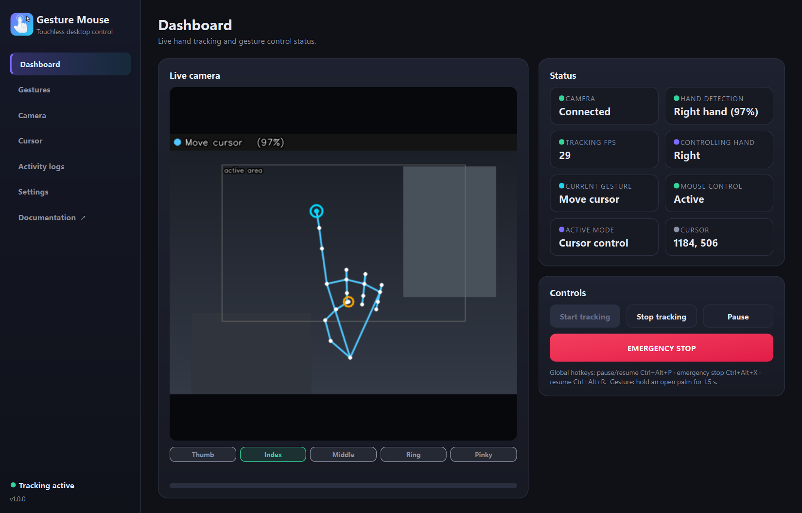

# Hand Gesture Mouse

Control your Windows mouse and windows with hand gestures in front of a webcam. Point with your
index finger to move the cursor, pinch to click, pinch-and-move to drag files, use two fingers to
scroll, three fingers to move windows - and show an open palm to stop everything instantly.



> **Full illustrated user guide with animated gesture tutorials:** open [`docs/index.html`](docs/index.html)
> in a browser (or click **Documentation** in the app's sidebar).

## Features

- Real-time hand tracking with MediaPipe Hand Landmarker (21 landmarks, left or right hand), ~25-30 FPS
- Smooth cursor: configurable active area, One Euro filter, dead zone, speed, acceleration (relative mode),
  precision slow-down while pinching, multi-monitor support
- Left click, double click, right click, long press (hold button or right click), drag & drop,
  vertical and horizontal scrolling (touchpad or joystick style)
- Window management: grab-and-move, maximize, minimize, restore, snap left/right, move to top,
  switch app, close (always confirmed)
- Safety: open-palm emergency stop (highest priority), pause/resume, global hotkeys, cooldowns,
  debouncing, duplicate-click prevention, protected system windows, safe startup defaults
- PySide6 dark-theme GUI: live preview with landmarks, status dashboard, per-gesture settings with
  illustrations, camera/cursor settings, activity log, system tray, start with Windows
- Persistent JSON configuration, rotating log file, built-in `--self-test` diagnostics
- Standalone Windows executable via PyInstaller (`build.bat`)

## Quick start (from source)

Requires Windows 10/11, 64-bit Python 3.10+ (tested with 3.13) and a webcam.

```bat
python -m venv .venv
.venv\Scripts\activate
pip install -r requirements.txt
python main.py
```

Press **Start tracking**, raise your index finger, and the cursor follows. Tracking never starts
by itself unless you enable it in Settings.

The MediaPipe model `models/hand_landmarker.task` is included. If it is missing:

```bat
curl -L -o models\hand_landmarker.task https://storage.googleapis.com/mediapipe-models/hand_landmarker/hand_landmarker/float16/latest/hand_landmarker.task
```

Command-line options: `--minimized` (start in the tray), `--start-tracking`, `--self-test`
(diagnostics report, add `--quiet` for no dialog), `--version`.

## Gestures

| Gesture | Hand action | Computer action |
|---|---|---|
| Index finger | Move index (other fingers folded) | Move cursor |
| Thumb + index pinch | Pinch and release | Left click |
| Two quick pinches | Pinch twice within 350 ms | Double click |
| Thumb + middle pinch | Pinch and release | Right click |
| Hold pinch | Maintain pinch 0.8 s | Long press (hold left button, or right click) |
| Hold and move pinch | Move while pinching | Drag and drop |
| Two fingers (together) vertical | Move up / down | Scroll |
| Two fingers horizontal | Move left / right | Horizontal scroll |
| Three fingers (index, middle, ring) | Hold and move | Move active window |
| Four fingers, thumb tucked | Quick swipe up / down / left / right | Maximize / restore-or-minimize / snap left / snap right (remappable) |
| Horns (index + pinky) | Hold 0.6 s | Switch application (Alt+Tab, remappable) |
| Thumb + pinky pinch | Hold 0.7 s, then repeat within 4 s | Close window (remappable) |
| Fist | Close hand | Freeze cursor (reposition your hand) |
| Open palm | Hold 1.5 s | **Emergency stop** |

Safety hotkeys (system-wide): `Ctrl+Alt+P` pause/resume, `Ctrl+Alt+X` emergency stop,
`Ctrl+Alt+R` resume after an emergency stop. Gestures can never resume control after a stop.

## Building the Windows executable

```bat
build.bat
```

Creates a virtual environment, installs dependencies, runs the unit tests and builds
`dist\HandGestureMouse\HandGestureMouse.exe` (≈240 MB folder; zip and ship the whole folder).
The target PC does not need Python. Run `HandGestureMouse.exe --self-test` on a new machine to
verify camera, model, tracking speed and the gesture engine.

## Configuration

All settings pages apply immediately and persist to JSON:

| File | Contents |
|---|---|
| `config/settings.json` | camera (device, resolution, FPS, mirror), tracking (FPS cap, hand, confidences), cursor (mode, speed, smoothing, acceleration, dead zone, region, monitor), app (tray, autostart, hotkeys) |
| `config/gestures.json` | per gesture: `enabled`, thresholds, `min_ms` detection time, `cooldown_ms`, durations; scroll/window options; `mappings` for window commands; emergency stop |

When running from source the files live in `config/`; the packaged app uses
`%APPDATA%\HandGestureMouse\config` (seeded from the bundled defaults on first run). Missing or
invalid values fall back to defaults; numbers are clamped to safe ranges; unknown mapping actions
are rejected. Set the `HGM_DATA_DIR` environment variable to use a different data folder.

## Architecture

```
camera thread ─► CameraManager (newest frame only)
                      │
tracking QThread ─► HandTracker (MediaPipe, 21 landmarks) ─► gesture_detector (finger states,
                    pinch distances in hand-sizes, motion) ─► gesture_classifier (pose + hysteresis,
                    PoseStabilizer debounce) ─► gesture_state (state machine, pure, unit-tested)
                      │ Decision: cursor mode + events
                      ▼
                    gesture_controller ─► cursor_controller (mapping, One Euro, dead zone)
                                       ─► mouse_controller (SendInput / PyAutoGUI)
                                       ─► scroll_controller, window_controller, keyboard_controller
GUI thread (PySide6) ◄── Qt signals (preview QImage, status, notices) ── tracking QThread
```

- **Separation:** detection and classification never touch the OS; the state machine emits
  events; only the controllers perform OS actions. This is what makes the gesture logic testable.
- **Conflicts:** one state at a time. While dragging, clicks/scrolls are not evaluated; the
  emergency palm is checked before every state; brief tracking dropouts hold the current gesture.
- **OS input:** on Windows a native `SendInput` backend addresses the full virtual desktop
  (negative coordinates on left/top monitors) and sends high-resolution wheel deltas. PyAutoGUI
  is the cross-platform backend and sends keyboard shortcuts; PyGetWindow performs window commands.

```
main.py                 entry point
app/                    core: camera, tracking, gestures, OS control, settings, logging, self-test
ui/                     PySide6 GUI pages, theme, widgets, gesture illustrations
docs/                   interactive HTML user guide (open index.html)
tests/                  pytest suite (OS actions mocked)
tools/                  icon rendering, screenshot capture, docs rendering, GUI smoke test
build/pyinstaller.spec  executable build definition (used by build.bat)
models/                 MediaPipe hand landmarker model
config/                 default / current configuration
```

## Testing

```bat
pip install -r requirements-dev.txt
python -m pytest
```

128 automated tests cover finger detection, classification (both hands), pinch hysteresis,
debouncing, click / double click / long press / drag state, duplicate-click prevention, scroll
direction and axis lock, window gestures and close confirmation, gesture priority, emergency stop,
pause, tracking dropouts, cursor mapping/smoothing/multi-monitor, and settings persistence. All
OS mouse actions are replaced by recording fakes - the suite never moves your mouse.

`tools/smoke_gui.py` runs the real GUI with the real camera (control paused) and
`main.py --self-test` checks the whole runtime stack. The manual checklist for real-hand testing
across monitors, resolutions, lighting, hands and Windows versions is in [TESTING.md](TESTING.md).

Developer tools: `tools/make_icons.py` (icon.svg → png/ico), `tools/capture_screenshots.py`
(GUI screenshots with a synthetic hand), `tools/render_docs.py` (renders the docs and freezes
animations for visual checks), `tools/render_sheet.py` (gesture illustration contact sheet).

## Troubleshooting

| Problem | Fix |
|---|---|
| Camera not detected | Camera page → *Scan for cameras*; close Teams/Zoom/Camera app; Windows Privacy → Camera → allow desktop apps |
| MediaPipe error | Check `models/hand_landmarker.task` exists; `pip install --force-reinstall mediapipe`; install the VC++ Redistributable |
| Hand not detected | Light the hand from the front; check *Controlling hand* (right/left/either); lower detection confidence |
| Cursor shaking | Increase smoothing and dead zone; better lighting; lower cursor speed |
| Accidental clicks | Lower pinch threshold, raise detection time / cooldown |
| Double click not recognised | Raise *Max time between pinches*; open the pinch fully between taps |
| Window won't move | Click it first (active window) or choose *window under the cursor*; admin windows need the app to run as admin |
| Anything else | `Ctrl+Alt+X` stops gesture control; see `logs/app.log`; run `--self-test` |

More detail: the *Troubleshooting* section of the user guide.

## Limitations

- Window management and start-with-OS are implemented for Windows only. On macOS/Linux the app
  runs from source with cursor/click/scroll via PyAutoGUI; window commands report "unsupported".
- Windows blocks synthetic input into elevated (administrator) windows, UAC prompts and the lock
  screen unless this app also runs elevated. Some games using raw input ignore synthetic input.
- Horizontal scrolling works only in applications that handle horizontal wheel messages.
- Gesture thresholds were tuned with synthetic landmark data and defaults from common usage; real
  hands, cameras and lighting vary, so use the Gestures page to fine-tune (see TESTING.md).

Hand tracking by [Google MediaPipe](https://ai.google.dev/edge/mediapipe/solutions/vision/hand_landmarker).
